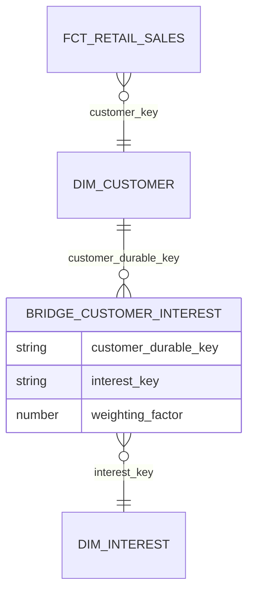

# Multivalued dimensions and bridge tables

<KimballRef chapters={[8, 10, 14]} techniques={['Multivalued Dimensions and Bridge Tables', 'Time Varying Multivalued Bridge Tables']}>
Customer interests and households (Ch. 8, 10) and multiple diagnoses per patient encounter (Ch. 14) are
Kimball's main examples.
</KimballRef>

The four-step process demands that every dimension be **single-valued** at the fact grain. Some business
relationships aren't:

- a customer has **several interests** (Backpacking, Climbing, Paddling);
- a bank account has **several owners**;
- a hospital visit has **several diagnoses**;
- a sales commission is **split** across reps.

Putting `interest_1`, `interest_2`, `interest_3` columns on the dimension is brittle, and you can't group by
"interest". The Kimball answer is a **bridge table**.

## The structure



<DbtFile path="models/marts/crm/bridge_customer_interest.sql" />

Key design decisions in the lab:

1. **Weighting factor** = 1 / (number of interests for the customer). Each customer's weights sum to exactly 1,
   and a singular test enforces it (`tests/assert_interest_weights_sum_to_one.sql`).
2. **Keyed on the durable key.** The customer dimension is Type 2; bridging on `customer_key` would
   require duplicating bridge rows for every customer version.
3. Kimball often bridges through a **group key** (fact → `interest_group_key` → bridge → interest) so that a
   *set* of interests is stored once and reused. With durable keys the customer itself acts as the group.

## Weighted vs impact reports

A bridge creates an intentional fan-out: each sale appears once per interest of its customer. You must decide
what that means:

<DbtFile path="analyses/weighted_vs_impact_interest_report.sql" />

| interest | weighted net sales | impact net sales |
|---|---|---|
| Trail Running | 320,392 | 613,512 |
| Climbing | 272,433 | 498,015 |
| Paddling | 228,783 | 466,078 |
| … | … | … |

- **Weighted** (× `weighting_factor`): allocates each sale across interests. The column **sums to the true
  total** (for customers with at least one interest).
- **Impact** (unweighted): "sales to customers interested in X". Each value is meaningful on its own, but the
  column **double counts**, so never sum it.

Both are legitimate; label them clearly. In BI tools, expose the weighted measure by default.

## Time-varying bridges

If interests change over time and you need "interests *at the time* of the sale", add `valid_from` / `valid_to`
to the bridge and join with the fact's date, just like a Type 2 dimension:

```sql
join bridge_customer_interest b
  on  b.customer_durable_key = c.customer_durable_key
  and f.transaction_ts >= b.valid_from
  and f.transaction_ts <  b.valid_to
```

## Alternatives (and when they're OK)

| Alternative | When acceptable |
|---|---|
| Positional columns (`primary_interest`, `secondary_interest`) | Exactly *n* ranked values that the business names ("primary diagnosis") |
| A concatenated attribute (`'Backpacking, Climbing'`) | Display only; useful *in addition* to the bridge |
| Snowflake `ARRAY` / `VARIANT` column | Convenient for engineers (`array_contains`), but most BI tools can't group by it; use alongside, not instead |

<Quiz questions={[
  {question: 'A customer has three interests and spends $300. What does the weighted report attribute to each interest?', options: ['$300 each', '$100 each', '$0', '$900 in total'], answer: 1, explanation: 'Each bridge row has weighting factor 1/3, so each interest gets $100 and the total ties to $300.'},
  {question: 'Why can\'t you sum the "impact" column across interests?', options: ['It has nulls', 'Each sale is counted once per interest, so the sum exceeds the true total', 'It is non-additive across time', 'You can'], answer: 1, explanation: 'Impact reports intentionally count the full amount under every applicable interest.'},
]} />
