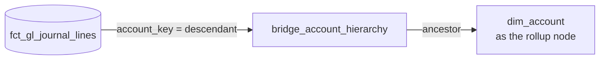

# Ragged and recursive hierarchies

<KimballRef chapters={[7, 9]} techniques={['Fixed Depth Positional Hierarchies', 'Slightly Ragged/Variable Depth Hierarchies', 'Ragged/Variable Depth Hierarchies with Hierarchy Bridge Tables', 'Ragged/Variable Depth Hierarchies with Pathstring Attributes']}>
The chart of accounts (Ch. 7) and the recursive employee reporting hierarchy (Ch. 9).
</KimballRef>

Product → category → department always has three levels: a **fixed-depth** hierarchy, which you simply flatten into
columns. Some hierarchies don't:

- **Chart of accounts:** Cash is two levels below the root; Store Rent is four.
- **Org chart:** a sales associate is five levels below the CEO; the ecommerce analyst is three.
- **Bill of materials, cost centers, geographic regions with optional levels.**

Kimball offers three tools, from simplest to most general.

## 1. Slightly ragged: flatten and pad

If the depth varies only a little, flatten to the **maximum** depth and **pad** short branches by repeating the
lowest real level:

<DbtFile path="models/marts/accounting/dim_account.sql" />

| account | depth | level_1 | level_2 | level_3 | level_4 |
|---|---|---|---|---|---|
| Cash | 2 | Assets | Cash | Cash | Cash |
| Payroll | 3 | Expenses | Operating Expenses | Payroll | Payroll |
| Store Rent | 4 | Expenses | Operating Expenses | Rent | Store Rent |

Users can drag `level_1 … level_4` into any BI tool. The padding guarantees no blank groups at any level.

## 2. Ragged: the hierarchy bridge

For arbitrary depth, and for questions like "everything under *Operating Expenses*, at any depth", build a
**bridge** with one row for **every ancestor/descendant pair**, including each node paired with itself:

<DbtFile path="models/marts/accounting/bridge_account_hierarchy.sql" />

The 18 lab accounts produce 41 bridge rows: 18 self-pairs, 14 at distance 1, 7 at distance 2 and 2 at distance 3.
Rolling up is then a simple join:

<DbtFile path="analyses/rollup_through_hierarchy_bridge.sql" />



Rules for a correct hierarchy bridge:

- Facts should attach to **leaves** (or each node exactly once). Otherwise a rollup counts some amounts twice.
- Filter by **one ancestor** (or one level) per query. Grouping by *all* ancestors at once double counts by design.
- `levels_between` lets you ask "direct reports only" (`= 1`) or "the whole subtree" (`>= 0`).

### The same pattern for an org chart

<DbtFile path="models/marts/hr/bridge_employee_reporting.sql" />

```sql
-- Sales rung up by everyone in the VP of Retail's organization (E002), at any depth
select count(distinct f.transaction_id) as baskets, sum(f.extended_net_sales_amount) as net_sales
from fct_retail_sales f
join dim_employee e              on e.employee_key = f.cashier_key
join bridge_employee_reporting b on b.subordinate_durable_key = e.employee_durable_key
where b.manager_employee_id = 'E002';
```

## 3. Pathstrings

Kimball's alternative to a bridge is a **pathstring attribute** encoding the path from the root, as
`dim_account.hierarchy_path` does (`5000 > 5200 > 5220 > 5221`). "Everything under 5200" becomes a
`like '%5200 >%'` or `startswith` filter, with no bridge needed. It's simple and BI-friendly, but awkward when
nodes move and limited to single-parent hierarchies.

## Snowflake notes

- `with recursive` CTEs (used above) work well for building bridges. `CONNECT BY` also exists if you prefer Oracle style.
- Build the bridge **in dbt, once**, never in BI-tool SQL at query time.
- For time-varying hierarchies (reorgs), add `valid_from` / `valid_to` to the bridge rows and join on the fact's
  date.

<Quiz questions={[
  {question: 'Why does the hierarchy bridge include each account paired with itself (levels_between = 0)?', options: ['To make the row count bigger', 'So a rollup to a node includes facts posted directly to that node, and leaf-level queries work through the same join', 'It is required by Snowflake recursive CTEs', 'For the Type 2 history'], answer: 1, explanation: 'Self-pairs make "everything under X" include X itself, so the same join works at every level.'},
  {question: 'In the padded flattening of dim_account, what is level_3 for Cash (depth 2)?', options: ['NULL', 'Unknown', 'Cash', 'Assets'], answer: 2, explanation: 'Short branches repeat the lowest real level downward so there are no blank groups.'},
]} />
