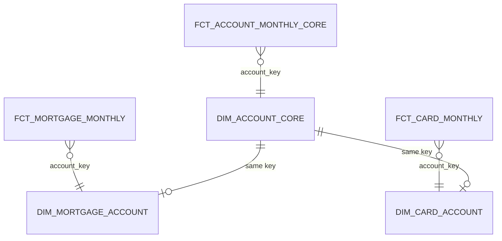

# Heterogeneous products (supertype/subtype)

<KimballRef chapters={[10, 16]} techniques={['Supertype and Subtype Schemas for Heterogeneous Products']}>
Banking products (checking vs mortgages vs credit cards, Ch. 10) and insurance lines (auto vs home, Ch. 16).
</KimballRef>

Some businesses sell products so different that they share almost no attributes or measures. A bank has checking
accounts (overdraft limit, ATM count), mortgages (rate type, term, property value) and credit cards (APR, credit
limit). One `dim_account` with every column is mostly nulls; one fact table with every measure is mostly zeros.

## The technique

1. A **supertype (core)** fact and dimension holding what's **common** to all products: account, customer,
   branch, month, balance, fees, interest. Enterprise-wide reports ("total balances by branch") use this.
2. **Subtype (custom)** fact and dimension tables per product line, each with the product-specific attributes and
   facts, **at the same grain and with the same keys** as the core.



## A Cascade Outfitters analogue

Cascade launches **gear rentals** and **guided trips** alongside merchandise. Rentals have deposit, rental days
and damage fees; trips have guide hours, participants and permit fees. A supertype/subtype design:

```sql
-- Supertype: every revenue line, whatever the product type
create table fct_revenue_lines_core (
    date_key int, customer_key varchar, store_key varchar, offering_key varchar,
    product_line varchar,              -- 'Merchandise' | 'Rental' | 'Trip'
    source_document_id varchar,        -- degenerate
    net_revenue_usd number(12,2), cost_usd number(12,2)
);

-- Subtype: rentals only, same grain and keys plus rental-specific facts
create table fct_rental_lines (
    date_key int, customer_key varchar, store_key varchar, offering_key varchar,
    source_document_id varchar,
    rental_days int, deposit_usd number(12,2), damage_fee_usd number(12,2)
);
```

In dbt, build the subtype models first and **union their common columns** into the core model, so
the core always reconciles with the subtypes.

<Quiz questions={[
  {question: 'What must the core and subtype fact tables share?', options: ['Nothing', 'The same grain and the same dimension keys for shared dimensions', 'Identical column lists', 'The same row counts'], answer: 1, explanation: 'Shared grain and keys let users move between the enterprise-wide core view and product-specific detail.'},
]} />
