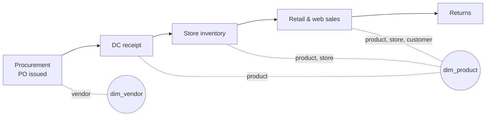

# The value chain and the roadmap

<KimballRef chapters={[4, 17]} techniques={['Value Chain', 'Enterprise Data Warehouse Bus Architecture']} />

## The value chain

Kimball's Inventory chapter describes the **value chain**: the sequence of business processes through which a
product flows. For Cascade:



Each link is a separate process, often with its own source system, and so its own fact table(s). The **product**
dimension conformed across all of them is what lets you follow the chain: "for the tents we bought from Ridgeline
in Q1, how fast did they sell through and what was the return rate?"

Questions that span the chain are the highest-value questions in most businesses:

- **Sell-through:** units received vs units sold, by product and week.
- **Days of supply:** on-hand inventory ÷ average daily sales.
- **Vendor quality:** receipts vs returns by vendor.
- **Margin by supply path:** purchase cost vs selling price by vendor and product.

## Delivering incrementally

Kimball's lifecycle delivers the warehouse **one business process (bus-matrix row) at a time**:

1. **Prioritize** rows by business value × feasibility (data quality, source access). The
   opportunity/stakeholder matrix supplies the value side.
2. **Build the conformed dimensions that row needs**, properly, the first time. Later rows reuse them.
3. **Deliver the row end to end**: facts, tests, documentation, semantic layer, a dashboard.
4. **Repeat.** Each new row is cheaper because most of its dimensions exist.

In dbt terms, each row is a deliverable unit you can ship behind a selector and an exposure:

```yaml
# models/exposures.yml
exposures:
  - name: merchandising_dashboard
    type: dashboard
    depends_on:
      - ref('fct_retail_sales')
      - ref('fct_promotion_coverage')
      - ref('agg_sales_monthly_category_store')
    owner: {name: Merchandising Analytics}
```

The anti-pattern is **independent data marts**: each department builds its own stars with its own dimensions, fast
at first, but nothing ties together and integration later means rebuilding. The bus architecture costs a little
more discipline up front and saves the rewrite.

<Quiz questions={[
  {question: 'What lets you follow a product from purchase order through to sale and return?', options: ['One giant fact table', 'A product dimension conformed across the procurement, inventory, sales and returns fact tables', 'Natural keys in every table', 'A data lake'], answer: 1, explanation: 'The conformed product dimension is the thread through the value chain.'},
]} />
