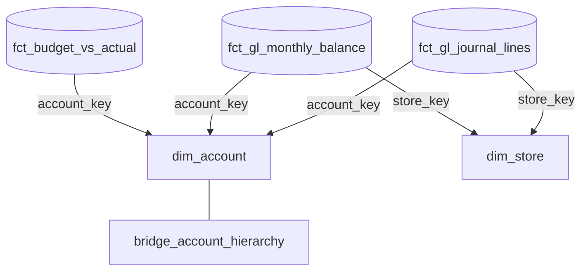

# Case study: Accounting

<KimballRef chapters={[7]} techniques={['Periodic Snapshot Fact Tables', 'Transaction Fact Tables', 'Ragged/Variable Depth Hierarchies with Hierarchy Bridge Tables', 'Slightly Ragged/Variable Depth Hierarchies', 'Consolidated Fact Tables', 'Year-to-Date Facts']} />

## The business

Finance asks:

- Monthly P&L and balance sheet by store, rolling up the chart of accounts at any level.
- Budget vs actual and variance by account and month.
- Drill from any balance to the journal lines behind it.

## The models

| Model | Type | Grain |
|---|---|---|
| `fct_gl_journal_lines` | Transaction | journal line |
| `fct_gl_monthly_balance` | Periodic snapshot (dense) | account × store × month |
| `fct_budget_vs_actual` | Consolidated | account × month |
| `dim_account` | Dimension with flattened, padded levels | account |
| `bridge_account_hierarchy` | Hierarchy bridge | ancestor × descendant |



<Tabs>
<TabItem value="bal" label="Monthly balance">
<DbtFile path="models/marts/accounting/fct_gl_monthly_balance.sql" />
</TabItem>
<TabItem value="bva" label="Budget vs actual">
<DbtFile path="models/marts/accounting/fct_budget_vs_actual.sql" />
</TabItem>
<TabItem value="acct" label="dim_account">
<DbtFile path="models/marts/accounting/dim_account.sql" />
</TabItem>
</Tabs>

## Answering the questions

```sql
-- Income statement by month using the padded levels
select d.year_month, a.level_1, a.level_2, sum(f.period_activity_amount) as activity
from fct_gl_monthly_balance f
join dim_account a on a.account_key = f.account_key
join dim_date d    on d.date_key = f.month_end_date_key
where a.financial_statement = 'Income Statement'
group by all
order by 1, 2, 3;

-- Budget vs actual for Operating Expenses at ANY depth, via the bridge
select d.year_month,
       sum(f.actual_amount) as actual, sum(f.budget_amount) as budget, sum(f.variance_amount) as variance
from fct_budget_vs_actual f
join bridge_account_hierarchy b on b.descendant_account_key = f.account_key
join dim_account anc            on anc.account_key = b.ancestor_account_key
join dim_date d                 on d.date_key = f.month_end_date_key
where anc.account_name = 'Operating Expenses'
group by 1
order by 1;

-- Year-to-date activity: compute it, don't store it
select d.year_month, a.account_name,
       sum(sum(f.period_activity_amount)) over (
           partition by a.account_name, d.calendar_year order by d.year_month
       ) as ytd_activity
from fct_gl_monthly_balance f
join dim_account a on a.account_key = f.account_key
join dim_date d    on d.date_key = f.month_end_date_key
group by d.year_month, a.account_name, d.calendar_year
order by 2, 1;
```

:::note Signs
The lab stores `signed_amount` as debit-positive. Revenue (a credit-normal account) therefore shows negative
balances. Real GL marts usually add a "reporting sign" attribute on `dim_account` (`+1`/`-1`) so statements display
naturally: `sum(amount * a.reporting_sign)`.
:::

<Quiz questions={[
  {question: 'Why is year-to-date activity computed at query time rather than stored?', options: ['Snowflake has no window functions', 'Stored YTD values are non-additive and break when earlier periods are restated', 'It is smaller', 'YTD is a dimension'], answer: 1, explanation: 'Kimball cautions that YTD facts are tempting but fragile; compute them from period facts.'},
]} />
