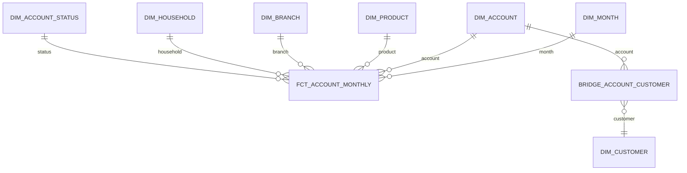

# Case study: Financial services (design)

<KimballRef chapters={[10]} techniques={['Periodic Snapshot Fact Tables', 'Multivalued Dimensions and Bridge Tables', 'Supertype and Subtype Schemas for Heterogeneous Products', 'Dynamic Value Bands', 'Type 4: Add Mini-Dimension', 'Hot Swappable Dimensions']} />

*Not built in the lab. Treat it as a design exercise with a worked answer.*

## The business

A regional bank, *Summit Credit Union*, wants to understand balances, product holdings and profitability by
account, customer and household, across checking, savings, mortgages and credit cards.

## Four steps

1. **Process:** account balance and activity, captured monthly.
2. **Grain:** one row per account per month-end (periodic snapshot). Transactions such as deposits and
   withdrawals are a separate, lower-grain fact.
3. **Dimensions:** month, account, primary customer, household, product, branch, account status.
4. **Facts:** ending balance (semi-additive), average daily balance, interest paid / earned, fees, transaction
   count (additive).

## The design



### Techniques this industry forces

| Challenge | Technique |
|---|---|
| Joint accounts have several owners | **Account–customer bridge** with weighting factors (e.g. 0.5 each) and a role (primary, joint, trustee) |
| Households are a key analysis unit | **Household dimension** on the fact (a household is single-valued per account per month) |
| Checking, mortgages and cards have very different attributes and facts | **Supertype/subtype**: core monthly fact + product-line facts ([lesson](/advanced/supertype-subtype)) |
| Balance bands change constantly | **Dynamic value banding** with a band table at query time ([lesson](/scd/type-4-mini-dimensions#dynamic-value-bands)) |
| Customer demographics and scores change monthly | **Mini-dimension** of banded credit score, income and tenure |

### A dbt sketch

```sql
-- models/marts/banking/fct_account_monthly.sql
{{ config(materialized='incremental', unique_key=['month_key', 'account_key'], incremental_strategy='delete+insert') }}

select
    year(b.month_end_date) * 100 + month(b.month_end_date) as month_key,
    a.account_key,
    p.product_key,
    br.branch_key,
    h.household_key,
    st.account_status_key,
    b.ending_balance,                          -- semi-additive
    b.average_daily_balance,                   -- semi-additive across months
    b.interest_amount,                         -- additive
    b.fee_amount,                              -- additive
    b.transaction_count                        -- additive
from {{ ref('int_account_month_end_balances') }} b
join {{ ref('dim_account') }} a          on  a.account_number = b.account_number
                                         and b.month_end_date >= a.valid_from
                                         and b.month_end_date <  a.valid_to   -- half-open interval
join {{ ref('dim_product') }} p          on p.product_code = b.product_code
join {{ ref('dim_branch') }} br          on br.branch_id = b.branch_id
join {{ ref('dim_household') }} h        on h.household_id = b.household_id
join {{ ref('dim_account_status') }} st  on st.status_code = b.status_code

where b.month_end_date >= dateadd(month, -2, current_date)

```

## Key queries

```sql
-- Household relationship depth: products held per household
select products_held, count(*) as households
from (select household_key, count(distinct product_key) as products_held
      from fct_account_monthly where month_key = 202506 group by 1)
group by 1 order by 1;

-- Balances by owner, with joint accounts allocated by the bridge weight
select c.customer_segment, sum(f.ending_balance * b.weighting_factor) as allocated_balance
from fct_account_monthly f
join bridge_account_customer b on b.account_key = f.account_key
join dim_customer c            on c.customer_key = b.customer_key
where f.month_key = 202506
group by 1;
```

## Exercise

<details>
<summary>The bank wants "number of customers with a mortgage AND a credit card". Which structures answer this, and how?</summary>

Use the monthly snapshot plus the account–customer bridge: for the chosen month, find customers (via the bridge)
whose accounts include product line "Mortgage", intersect with those including "Credit Card", then count. A
**behavior study group** table of those customer keys makes the cohort reusable across other facts.
</details>
