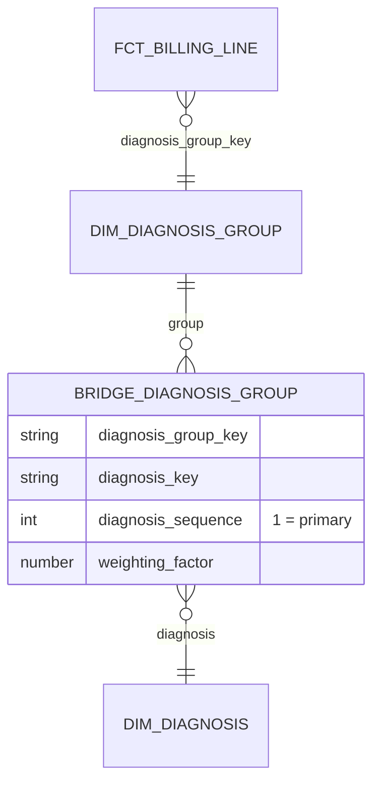

# Case study: Healthcare (design)

<KimballRef chapters={[14]} techniques={['Multivalued Dimensions and Bridge Tables', 'Measure Type Dimensions', 'Text Comments Dimension', 'Role-Playing Dimensions', 'Accumulating Snapshot Fact Tables']} />

*Not built in the lab. Treat it as a design exercise with a worked answer.*

## The business

A hospital network analyzes billing (charges, payments, adjustments) and clinical outcomes (lab results, vitals).

## Billing line fact

- **Grain:** one row per billed line item (procedure or service) on a claim.
- **Dimensions:** service date, billing date, patient, provider (role-playing: attending, referring), facility,
  procedure, payer, **diagnosis group**.
- **Facts:** billed amount, allowed amount, paid amount, adjustment amount (all additive).

### Multiple diagnoses: the diagnosis group bridge

An encounter has a primary diagnosis and several secondary ones. Kimball's healthcare design puts a
**diagnosis group key** on the fact, pointing to a bridge:



The **same set of diagnoses** reuses the same group key, so the bridge stays compact. In dbt, hash the sorted
list of codes:

```sql
select
    {{ dbt_utils.generate_surrogate_key(["listagg(diagnosis_code, '|') within group (order by diagnosis_code)"]) }} as diagnosis_group_key,
    encounter_id
from {{ ref('stg_ehr__encounter_diagnoses') }}
group by encounter_id
```

A positional `primary_diagnosis_key` directly on the fact is also common: "primary" is a meaningful,
single-valued role.

## Clinical measurements: measure type dimension

Lab panels have hundreds of possible tests, each patient getting a few. Rather than a 500-column fact, use
**one row per measurement** with a measure type dimension:

| Column | Example |
|---|---|
| `encounter_key`, `patient_key`, `collected_date_key` | |
| `measure_type_key` → `dim_measure_type` | "LDL Cholesterol", unit "mg/dL", panel "Lipid", normal range 0–100 |
| `measured_value` | 128 |
| `abnormal_indicator` (junk dim) | "High" |

## Text comments

Physician notes go in a **comments dimension** (one row per distinct note), referenced by the fact, never as a
free-text column on a large fact.

## Exercise

<details>
<summary>Billing wants a <strong>claims pipeline</strong> report: submitted → adjudicated → paid → (denied/appealed). Design it.</summary>

An **accumulating snapshot** at claim grain with date keys for submitted, adjudicated, paid, denied and appeal
filed (`-2` until reached); dimensions payer, facility, claim type (junk: inpatient/outpatient, electronic/paper);
facts billed/allowed/paid amounts, lags (submitted→paid), and counters. If claims can loop (resubmissions), keep a
transaction fact of claim status changes alongside it.
</details>
