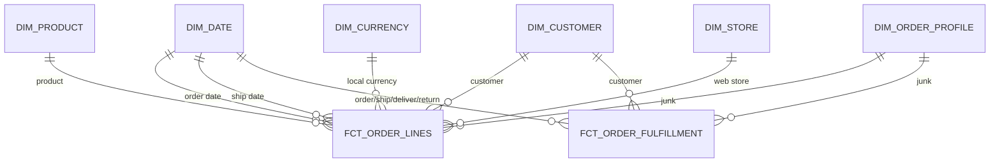

# Case study: Order management

<KimballRef chapters={[6]} techniques={['Role-Playing Dimensions', 'Junk Dimensions', 'Degenerate Dimensions', 'Header/Line Fact Tables', 'Allocated Facts', 'Multiple Currency Facts', 'Accumulating Snapshot Fact Tables', 'Lag/Duration Facts', 'Audit Dimensions']}>
Kimball's Order Management chapter packs in more techniques than any other. It's worth re-reading after this case study.
</KimballRef>

## The business

The e-commerce team asks:

- Order volume and value by product, customer and channel, in local currency and USD.
- What do shipping charges look like by product and ship method?
- How fast do orders move from placed to shipped to delivered? What share are returned?
- Do gift orders behave differently?

## Two fact tables

| Fact | Type | Grain |
|---|---|---|
| `fct_order_lines` | Transaction | order line |
| `fct_order_fulfillment` | Accumulating snapshot | order |



## Techniques at work

| Technique | Where | Lesson |
|---|---|---|
| Role-playing dates | `order_date_key`, `ship_date_key`, `dim_order_date`, `dim_ship_date` | [Role-playing](/dimensions/role-playing-dimensions) |
| Junk dimension | `dim_order_profile` (payment × ship method × gift) | [Junk dimensions](/dimensions/junk-dimensions) |
| Degenerate dimension | `order_number` | [Degenerate](/dimensions/degenerate-dimensions) |
| Header → line allocation | `int_order_lines_allocated` | [Allocation](/advanced/header-line-and-allocation) |
| Dual currency | `*_local` + `*_usd` + `dim_currency` | [Currencies](/advanced/multiple-currencies-and-units) |
| Conformed store | Web orders use the Web Store member of `dim_store` | [Conformed dims](/dimensions/conformed-dimensions) |
| Fulfillment pipeline | `fct_order_fulfillment` | [Accumulating snapshots](/facts/accumulating-snapshot-fact-tables) |

<Tabs>
<TabItem value="lines" label="fct_order_lines">
<DbtFile path="models/marts/orders/fct_order_lines.sql" />
</TabItem>
<TabItem value="ful" label="fct_order_fulfillment">
<DbtFile path="models/marts/orders/fct_order_fulfillment.sql" />
</TabItem>
</Tabs>

## Answering the questions

```sql
-- Fulfillment speed by ship method
select op.ship_method,
       count(*)                          as orders,
       avg(order_to_ship_lag_days)       as avg_days_to_ship,
       avg(ship_to_delivery_lag_days)    as avg_days_in_transit,
       sum(returned_count) / sum(delivered_count) as return_rate
from fct_order_fulfillment f
join dim_order_profile op on op.order_profile_key = f.order_profile_key
group by 1
order by 1;

-- Shipping revenue by product category (allocated), USD
select p.category, sum(f.allocated_shipping_amount_usd) as shipping_revenue_usd
from fct_order_lines f
join dim_product p on p.product_key = f.product_key
group by 1
order by 2 desc;

-- Pipeline right now: where are open orders?
select current_order_status, count(*) as orders
from fct_order_fulfillment
group by 1;
```

On the lab data: 589 delivered orders averaging about 4.7 days from order to delivery, 44 returned, 17 in transit
and 6 not yet shipped.

<Quiz questions={[
  {question: 'Where does the web channel get its store_key in fct_order_lines?', options: ['NULL', 'The Web Store member (store 999) of the conformed store dimension', 'A separate web_store dimension', 'Unknown (-1)'], answer: 1, explanation: 'Modeling the web as a store member keeps the store dimension conformed across channels, so all-channel reports work.'},
]} />
