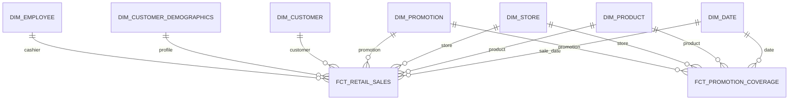

# Case study: Retail sales

<KimballRef chapters={[3]} techniques={['Four-Step Dimensional Design Process', 'Transaction Fact Tables', 'Calendar Date Dimensions', 'Degenerate Dimensions', 'Factless Fact Tables', 'Dimension Surrogate Keys']}>
Kimball's grocery-chain POS case study is the foundation of the whole book. This is the same exercise for a
specialty outdoor retailer.
</KimballRef>

## The business

Cascade's merchandising team asks:

- What sells, where, and when, by product hierarchy, store geography and fiscal calendar?
- Do promotions lift sales, or just give away margin? Which promoted products didn't sell at all?
- What's in a typical basket? Which products are bought together?
- How do loyalty members differ from anonymous shoppers? Does behavior vary by age or income band?

## Four steps

1. **Process:** POS retail sales.
2. **Grain:** one row per product line on a POS ticket (atomic).
3. **Dimensions:** date, product, store, promotion, customer, customer demographics (mini-dim), cashier
   (employee role); degenerate `transaction_id`, `line_number`, `register_id`.
4. **Facts:** quantity, gross/discount/net sales, cost and gross profit (all additive, extended).

Plus the **promotion coverage** factless fact for the "what didn't sell" question.

## The model



## Implementation walkthrough

| Step | Model | Lesson |
|---|---|---|
| Clean POS lines | `stg_cascade__pos_transactions` | [Project structure](/dbt/project-structure) |
| Product history | `int_product_versions` → `dim_product` | [Type 2](/scd/type-2) |
| Customer history | `int_customer_versions` → `dim_customer` | [Type 2](/scd/type-2) |
| Demographics | `dim_customer_demographics` | [Type 4](/scd/type-4-mini-dimensions) |
| Promotions | `dim_promotion` with "No Promotion" row | [Special members](/dimensions/special-members) |
| The fact | `fct_retail_sales` (incremental merge) | [Transaction facts](/facts/transaction-fact-tables) |
| Coverage | `fct_promotion_coverage` | [Factless facts](/facts/factless-fact-tables) |
| Rollup | `agg_sales_monthly_category_store` | [Aggregates](/advanced/aggregates-and-shrunken-dimensions) |

<DbtFile path="models/marts/retail/fct_retail_sales.sql" collapsed />

## Answering the questions

<Tabs>
<TabItem value="hier" label="Sales by hierarchy">

```sql
select d.fiscal_year_quarter, p.department, p.category, s.store_region,
       sum(f.extended_net_sales_amount)    as net_sales,
       sum(f.extended_gross_profit_amount) / nullif(sum(f.extended_net_sales_amount), 0) as gross_margin_pct
from fct_retail_sales f
join dim_date d    on d.date_key = f.date_key
join dim_product p on p.product_key = f.product_key
join dim_store s   on s.store_key = f.store_key
group by all
order by 1, 2, 3, 4;
```

</TabItem>
<TabItem value="promo" label="Promotion lift">

```sql
-- Average units per product-store-day (on days with sales), on promotion vs not
with daily as (
    select f.date_key, f.product_key, f.store_key,
           max(iff(pr.promo_code <> 'NONE', 1, 0)) as any_promoted_sale,
           sum(f.sales_quantity)                   as units
    from fct_retail_sales f
    join dim_promotion pr on pr.promotion_key = f.promotion_key
    group by all
)
select p.category,
       avg(iff(c.product_key is not null, units, null)) as avg_units_on_promo_days,
       avg(iff(c.product_key is null, units, null))     as avg_units_other_days
from daily x
join dim_product p on p.product_key = x.product_key
left join (select distinct date_key, product_key, store_key from fct_promotion_coverage) c
  on  c.date_key = x.date_key and c.product_key = x.product_key and c.store_key = x.store_key
group by 1
order by 1;
```

</TabItem>
<TabItem value="basket" label="Baskets">

```sql
select s.store_name, d.weekday_indicator,
       count(distinct f.transaction_id) as baskets,
       round(sum(f.extended_net_sales_amount) / count(distinct f.transaction_id), 2) as avg_basket_value
from fct_retail_sales f
join dim_store s on s.store_key = f.store_key
join dim_date d  on d.date_key = f.date_key
group by all
order by 1, 2;
```

</TabItem>
<TabItem value="loyalty" label="Loyalty vs anonymous">

```sql
select c.loyalty_tier, dm.age_band,
       count(distinct f.transaction_id)  as baskets,
       sum(f.extended_net_sales_amount)  as net_sales
from fct_retail_sales f
join dim_customer c               on c.customer_key = f.customer_key
join dim_customer_demographics dm on dm.customer_demographics_key = f.customer_demographics_key
group by all
order by 1, 2;
```

</TabItem>
</Tabs>

## Design review: questions to ask

- Is the grain truly the line? (Could the same SKU appear on two lines of a ticket? Yes, so `line_number` is part
  of the grain.)
- Should returns be negative sales lines in this fact, or a separate returns process? (Kimball: often in the same
  fact if they arrive through the same POS process, with a transaction-type dimension or a returns indicator.)
- Do we need time of day as a dimension, or is the timestamp enough?
- Who decides which product attributes are Type 2?

<Quiz questions={[
  {question: 'Why is line_number part of the retail sales grain?', options: ['For sorting', 'Because the same SKU can appear on more than one line of a ticket', 'Because Snowflake needs it', 'It is not'], answer: 1, explanation: 'Without line_number, two lines of the same product on one ticket would collide.'},
]} />
