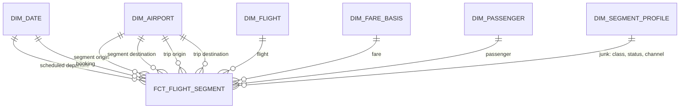

# Case study: Transportation (design)

<KimballRef chapters={[12]} techniques={['Role-Playing Dimensions', 'Multiple Time Zones', 'Transaction Fact Tables', 'Degenerate Dimensions']} />

*Not built in the lab. Treat it as a design exercise with a worked answer.*

## The business

An airline's revenue management team wants passenger revenue, load factors and route performance.

## The grain question

A passenger's **ticket** (trip) from Seattle to Boston might fly SEA → DEN → BOS: two **segments**.

| Grain | One row per... | Answers well | Awkward for |
|---|---|---|---|
| **Segment** (atomic) | passenger per flight segment | Load factors, per-flight revenue, crew planning | "Trips from SEA to BOS" (needs linking) |
| **Trip** | passenger per origin–destination journey | Market demand (O&D), trip revenue | Flight-level operations |

Kimball's answer: **build the segment fact (atomic), and also a trip-level fact derived from it**, because
both perspectives are used constantly.

## Segment fact design



- **Role-playing airport** four times: segment origin and destination, and *trip* origin and destination. Carrying
  the trip airports on every segment row lets you answer O&D questions without linking rows.
- **Degenerates:** ticket number, segment sequence number, PNR (booking reference).
- **Facts:** segment revenue (allocated from the ticket, see [allocation](/advanced/header-line-and-allocation)),
  segment miles, base fare, taxes, upgrade fees.
- **Time zones:** local departure date and time at the origin, local arrival at the destination, and UTC for
  computing durations. All are role-playing date and time keys.

```sql
-- Snowflake: deriving local and UTC date keys from a UTC timestamp and the airport's zone
{{ date_key("convert_timezone('UTC', o.time_zone, s.departure_ts_utc)::date") }} as departure_local_date_key,
{{ date_key('s.departure_ts_utc::date') }}                                      as departure_utc_date_key
```

## Exercise

<details>
<summary>How do you compute <strong>load factor</strong> (passengers ÷ seats) by route and month?</summary>

Passengers come from the segment fact (count of passenger-segment rows). Seats come from a **flight capacity**
fact or the `dim_flight` attribute (aircraft seat count) at the flight-leg grain. Aggregate both to route × month
separately (drill-across), then divide. Don't put seat counts on passenger rows, or summing them inflates
capacity by the number of passengers.
</details>
