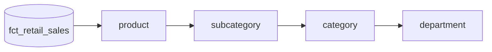
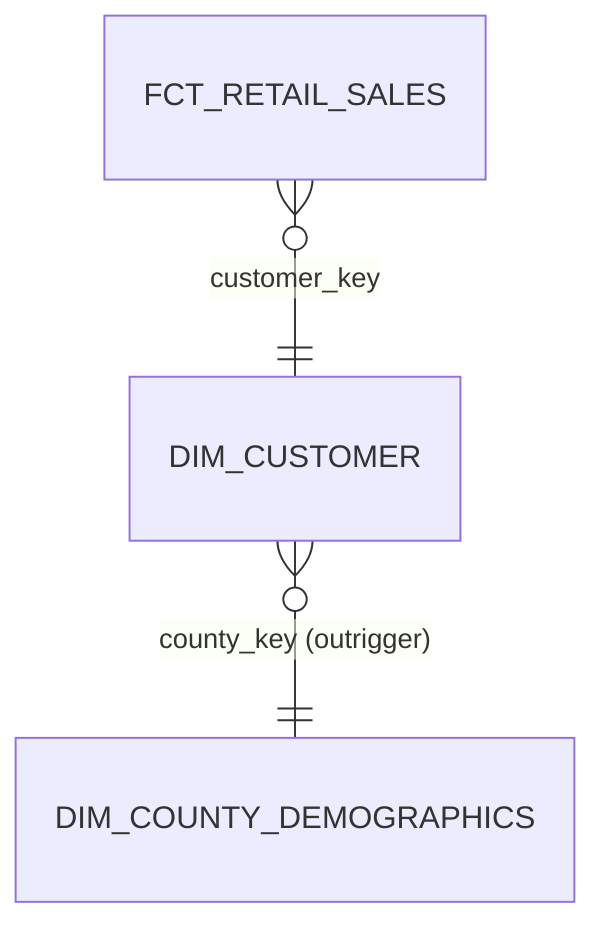

# Snowflaking and outriggers

<KimballRef chapters={[3, 8]} techniques={['Snowflaked Dimensions', 'Outrigger Dimensions', 'Dimension-to-Dimension Table Joins']} />

## Snowflaking

A **snowflaked dimension** normalizes its hierarchy into separate tables:



Kimball recommends **against** snowflaking in the presentation layer:

- **Harder to understand.** Users see four tables where they think of one product.
- **More joins.** Every query crossing levels needs the chain; BI tools generate worse SQL.
- **Saves almost nothing.** Dimension tables are small; the repeated category names cost kilobytes.
- **Browsing is slower.** Listing the categories in a department needs joins instead of a `select distinct` on one table.

The flattened alternative is what the lab's `dim_product` does: department, category and subcategory are
columns on the product row.

:::note "Snowflake" the database vs "snowflake" the schema
The names are unrelated. The Snowflake database handles star schemas extremely well; nothing about it
favours snowflaked schemas.
:::

### In dbt: normalize upstream, flatten in the mart

You'll often have normalized tables upstream (staging models for `categories`, `departments`). That's fine.
Join them **in the dimension model** so the mart is flat:

```sql
-- models/marts/core/dim_product.sql (sketch)
select p.sku, p.product_name, sc.subcategory_name, c.category_name, d.department_name
from {{ ref('stg_merch__products') }} p
join {{ ref('stg_merch__subcategories') }} sc using (subcategory_id)
join {{ ref('stg_merch__categories') }} c using (category_id)
join {{ ref('stg_merch__departments') }} d using (department_id)
```

## Outriggers

An **outrigger** is a secondary dimension referenced by a dimension rather than by the fact table. Kimball
allows it sparingly, when:

- a cluster of attributes has a **different grain or update cadence** from the main dimension, e.g. county-level
  demographics (hundreds of attributes, refreshed annually) attached to a customer through their county;
- a dimension needs a **date attribute that should be fully described**, e.g. a product's `first_available_date_key`
  pointing at `dim_date` so you can group products by launch fiscal quarter.



Use them sparingly: each outrigger is a little snowflake. For small attribute sets, denormalize into the
main dimension instead.

## Dimension-to-dimension joins

The rule of thumb: **dimensions relate to each other through the fact table**. If you want to know which
products sell in which stores, the answer is in `fct_retail_sales`, not in a product–store link table.

The exceptions are outriggers, and a few patterns like the [Type 5](/scd/types-5-6-7) "current mini-dimension"
outrigger.

<Quiz questions={[
  {question: 'What is Kimball\'s main objection to snowflaking dimensions in the presentation layer?', options: ['It uses too much storage', 'It makes the model harder to understand and query, for negligible savings', 'Snowflake the database cannot join normalized tables', 'It breaks surrogate keys'], answer: 1, explanation: 'Dimension tables are small; normalizing them saves little and costs usability and query simplicity.'},
  {question: 'When is an outrigger reasonable?', options: ['Always, to save space', 'For a large cluster of attributes at a different grain or update cadence, such as county demographics', 'Never', 'For every hierarchy level'], answer: 1, explanation: 'Outriggers are a narrow exception for attribute groups that genuinely have their own grain or lifecycle.'},
]} />
