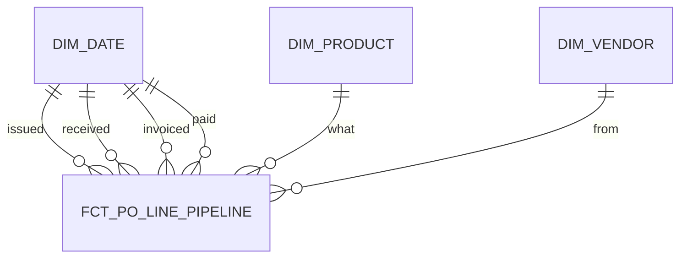

# Accumulating snapshot fact tables

<KimballRef chapters={[4, 6, 13, 16]} techniques={['Accumulating Snapshot Fact Tables', 'Lag/Duration Facts', 'Role-Playing Dimensions']}>
Introduced in Inventory (Ch. 4), developed for order fulfillment (Ch. 6), and reused for admissions pipelines
(Ch. 13) and insurance claims (Ch. 16).
</KimballRef>

Some processes have a **defined beginning, a standard set of milestones, and an end**: an order is placed,
picked, shipped, delivered; a PO is issued, received, invoiced, paid; a claim is opened, assessed, settled.
Analysts want to know about the *pipeline*: how long between steps? how many are stuck where?

An **accumulating snapshot** has:

- **Grain:** one row per *instance* of the process (per PO line, per order, per claim).
- **One date foreign key per milestone**, each a role played by the date dimension.
- **Lag facts**: the duration between milestones.
- **Milestone counters**: 1/0 flags whose sum counts instances reaching each step.
- Rows that are **updated** as the instance progresses. This is the only fundamental fact type that revisits rows.

## Procurement pipeline

<DbtFile path="models/marts/procurement/fct_po_line_pipeline.sql" />



### Unreached milestones point at a real row

A PO line that hasn't been received yet has no receipt date. Rather than a **null foreign key**, which breaks
inner joins and BI tools, it points at the date dimension's special **"Not Yet Happened"** row (key `-2`):

<DbtFile path="models/marts/core/dim_date.sql" lines={[74, 86]} title="dim_date.sql (special rows)" />

The *lag fact*, on the other hand, is legitimately `null`: the duration isn't known yet. Null facts are fine
(aggregates ignore them); null foreign keys are not.

## Querying a pipeline

```sql
-- Where is everything right now, and how fast does it move?
select
    v.vendor_name,
    count(*)                                   as po_lines,
    sum(received_count)                        as received,
    sum(paid_count)                            as paid,
    avg(issued_to_received_lag_days)           as avg_days_to_receive,
    avg(invoiced_to_paid_lag_days)             as avg_days_to_pay,
    sum(iff(pipeline_status = 'Open', 1, 0))   as still_open
from fct_po_line_pipeline f
join dim_vendor v on v.vendor_key = f.vendor_key
group by all
order by avg_days_to_receive desc;
```

On the lab data this shows 167 paid lines averaging about 12.7 days from issue to receipt and about 28.5 days
from invoice to payment.

## Building accumulating snapshots in dbt

| Approach | How | When |
|---|---|---|
| **Full rebuild** (`table`) | Pivot the milestone events per instance every run | Small or medium volumes. Simple and always correct. The lab does this. |
| **Incremental merge** | `unique_key` = instance key; select only instances with new milestone events since the last run | Large volumes. Make sure every column is recomputed for the changed instances. |

The key is computing milestones from an **event log**, as the lab pivots `stg_cascade__procurement_transactions`,
rather than trying to apply partial updates to existing rows. Rebuilding the changed rows from all their events
is idempotent.

## Pitfalls

- **Using it for processes without a predictable pipeline.** If steps repeat, loop or branch, use a transaction
  fact of status changes instead (Kimball sometimes pairs both).
- **Too many milestones.** If a dozen dates are rarely populated, reconsider which milestones matter.
- **Null date keys.** Use special date rows.

<Quiz questions={[
  {question: 'What distinguishes an accumulating snapshot from the other two fundamental fact types?', options: ['It has no dimensions', 'Its rows are updated as the process instance progresses', 'It only stores balances', 'It has no date dimension'], answer: 1, explanation: 'Transaction and periodic snapshot rows are written once. Accumulating snapshot rows are revisited as milestones occur.'},
  {question: 'A web order has not shipped yet. What should ship_date_key contain?', options: ['NULL', 'The order date', 'The key of the "Not Yet Happened" special date row', '9999-12-31'], answer: 2, explanation: 'Foreign keys should never be null; a special row with a meaningful label keeps joins and reports correct.'},
  {question: 'Which is a lag fact?', options: ['ship_date_key', 'order_to_delivery_lag_days', 'order_count', 'current_order_status'], answer: 1, explanation: 'Lag (duration) facts store elapsed time between milestones so analysts can simply average them.'},
]} />

## Exercise

<details>
<summary>Design an accumulating snapshot for Cascade's <strong>customer returns (RMA)</strong> process: requested → label sent → item received → inspected → refunded.</summary>

- **Grain:** one row per RMA line (one returned product).
- **Date keys:** `rma_requested_date_key`, `label_sent_date_key`, `item_received_date_key`,
  `inspected_date_key`, `refund_date_key`, all role-playing `dim_date`, using `-2` until reached.
- **Other dimensions:** product, customer, original store/channel, return reason (a small dimension),
  inspection outcome (junk dimension: restockable? damaged? missing parts?).
- **Degenerates:** RMA number, original order number.
- **Facts:** returned quantity, refund amount, restocking fee, lags (request→receive, receive→refund,
  request→refund), counters (received_count, refunded_count).
</details>
