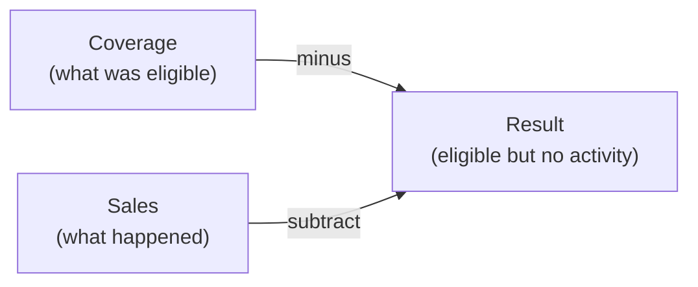

# Factless fact tables

<KimballRef chapters={[3, 9, 13]} techniques={['Factless Fact Tables']}>
Promotion coverage (Ch. 3) and attendance/registration events (Ch. 13) are Kimball's main examples.
</KimballRef>

A **factless fact table** has dimension keys but no numeric measures: the *existence of the row* is the fact.
There are two flavors.

## 1. Event tracking

Some events have nothing to measure: a student attended a class, an employee was hired, a customer
contacted support. You still want to count them by every dimension.

The lab's HR events table is nearly factless. Its "facts" are just 1/0 **counters** that make `SUM()`
convenient:

<DbtFile path="models/marts/hr/fct_employee_events.sql" />

```sql
-- Hires and terminations by store by quarter
select s.store_name, d.calendar_year_quarter,
       sum(hire_count) as hires, sum(termination_count) as terminations
from fct_employee_events f
join dim_store s on s.store_key = f.store_key
join dim_date d  on d.date_key = f.event_date_key
group by all;
```

## 2. Coverage

This is the more subtle case. Sales facts only record what **happened**. Kimball's classic question:

> **Which products were on promotion but didn't sell?**

You can't answer that from `fct_retail_sales`; an unsold product has no rows. You need a record of what
was *eligible*: a **coverage table**.

<DbtFile path="models/marts/retail/fct_promotion_coverage.sql" />

Then the answer is coverage **minus** activity:

<DbtFile path="analyses/promoted_products_that_did_not_sell.sql" />

On the lab data, the top result is the Ember 20F Sleeping Bag at Portland Pearl: promoted for 21 days of Winter
Clearance without a single promoted sale.



Other coverage examples: which students enrolled in a course but never attended (registration vs attendance);
which customers were sent a campaign but didn't respond; which stores were scheduled to receive a delivery that
didn't arrive.

## Pitfalls

- **Inventing a fake measure** like `amount = 0`. A counter column of 1 is fine; a meaningless amount isn't.
- **Building coverage at the wrong grain.** Coverage must match the activity's grain on the shared dimensions,
  or the `MINUS` compares apples to oranges.
- **Coverage tables can be big** (every eligible combination × day). In Snowflake that's usually fine; otherwise
  store date ranges and expand them at query time.

<Quiz questions={[
  {question: 'Why can\'t fct_retail_sales alone tell you which promoted products failed to sell?', options: ['It lacks a promotion key', 'Fact tables only contain rows for events that happened', 'Promotions are a Type 2 dimension', 'Snowflake cannot do anti-joins'], answer: 1, explanation: 'Transaction facts are sparse. To find non-events you need a record of what could have happened: the coverage table.'},
  {question: 'Which of these is a coverage factless fact table?', options: ['Student attendance events', 'Course registrations (eligible to attend)', 'Exam scores', 'Tuition payments'], answer: 1, explanation: 'Registrations record eligibility; subtracting attendance gives who registered but never attended.'},
]} />
