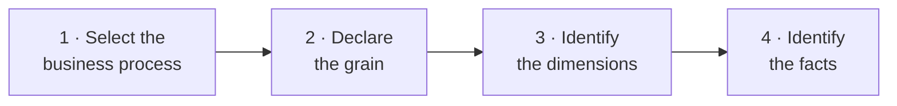
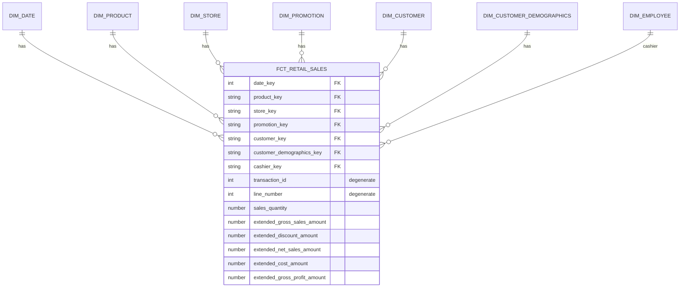

# The four-step design process

<KimballRef chapters={[2, 3]} techniques={['Four-step dimensional design process', 'Business processes', 'Grain', 'Dimensions for descriptive context', 'Facts for measurements']}>
Chapter 3 (Retail Sales) introduces the process with a grocery-chain POS case study; this lesson does the same
for Cascade Outfitters. Chapter 18 covers how to run it with business users.
</KimballRef>

Kimball's design method is four decisions, **made in this order**:

The order matters. Grain before dimensions and facts is the most common thing people skip, and skipping it
causes most broken models.

## Step 1: Select the business process

A **business process** is an operational activity the organization performs that generates measurable
events: taking an order, ringing up a sale, receiving a shipment, paying an invoice, enrolling a student.

Processes are **verbs**, usually backed by a source system that captures them. They are *not* departments
("Marketing") or reports ("Weekly Sales Dashboard"). Marketing may care about sales, web sessions and email
campaigns: three processes, three fact tables.

> **Cascade Outfitters:** Merchandising wants to understand what sells, where, when, and under which promotions.
> The process is **point-of-sale retail sales**, captured by the POS system.

## Step 2: Declare the grain

The grain states **exactly what one row in the fact table represents**, in business terms. It's a contract.

> **Grain:** one row per product line item on a POS transaction (ticket).

Kimball's strong preference is the **most atomic grain** the process captures. Atomic data:

- answers questions nobody has thought of yet (you can always roll up; you can never drill below your grain);
- accepts new dimensions gracefully;
- is robust to changing requirements.

If you only stored *daily sales by product by store*, you could never answer "what's the average basket size?" or
"which products are bought together?". Those need the ticket.

See [Declaring the grain](./declaring-the-grain) for how to write grain statements and catch violations.

## Step 3: Identify the dimensions

Once the grain is fixed, the dimensions almost fall out: ask "how do business people *describe* one of these
rows?" Every dimension must be **single-valued for each fact row** at the declared grain.

| Question | Dimension | Notes |
|---|---|---|
| When? | `dim_date` | Sale date; time of day kept as a timestamp on the fact |
| What? | `dim_product` | SKU with brand / subcategory / category / department |
| Where? | `dim_store` | Store with district / region, including the Web Store |
| Why? | `dim_promotion` | A **causal** dimension; "No Promotion in Effect" is a real row |
| Who bought? | `dim_customer` | Loyalty members; anonymous shoppers get a special row |
| Who rang it up? | `dim_employee` (cashier role) | Role-playing the employee dimension |
| Which ticket? | `transaction_id` | **Degenerate dimension** on the fact table |

If a candidate dimension takes *several* values per row ("all the customer's interests"), it isn't a simple
dimension at this grain. It needs a [bridge table](/advanced/multivalued-dimensions-and-bridges).

## Step 4: Identify the facts

Ask "what does the process **measure**?" Facts must be **true to the grain**: a fact that only exists per
ticket (say, a ticket-level coupon) doesn't belong on a line-grain table unless it's
[allocated](/advanced/header-line-and-allocation) to lines.

| Fact | Additivity | Notes |
|---|---|---|
| `sales_quantity` | Additive | |
| `extended_gross_sales_amount` | Additive | quantity × unit price |
| `extended_discount_amount` | Additive | |
| `extended_net_sales_amount` | Additive | gross − discount |
| `extended_cost_amount` | Additive | quantity × unit cost |
| `extended_gross_profit_amount` | Additive | net − cost (stored because everyone needs it) |
| ~~gross margin %~~ | Non-additive | **Don't store.** Compute as `sum(profit) / sum(net)` at query time |

## The result

The dbt model's header comment records the four decisions. Do the same in every fact model you write; it's the
best documentation a reviewer can get.

<DbtFile path="models/marts/retail/fct_retail_sales.sql" lines={[11, 24]} title="fct_retail_sales.sql (header)" />

<Quiz questions={[
  {question: 'Which of these is a business process in Kimball terms?', options: ['The Finance department', 'The monthly board report', 'Receiving goods at the distribution center', 'The product master table'], answer: 2, explanation: 'Business processes are operational activities that generate measurement events. Departments and reports are consumers, not processes.'},
  {question: 'Why declare the grain BEFORE choosing dimensions and facts?', options: ['dbt requires it', 'The grain determines which dimensions are single-valued and which facts are true to each row', 'It is only a documentation step', 'So you can choose the smallest table'], answer: 1, explanation: 'Dimensions and facts are only valid if they make sense for exactly one row at the declared grain.'},
  {question: 'A ticket-level "loyalty points redeemed" amount is captured once per POS ticket. What should you do with it in a line-grain fact?', options: ['Repeat it on every line', 'Put it on the first line only', 'Allocate it to lines, or model it in a separate ticket-grain fact table', 'Store it in the store dimension'], answer: 2, explanation: 'Repeating it double counts; first-line-only is a trap for anyone filtering by product. Allocate it or keep it at its native grain.'},
]} />

## Exercise

Design a star for Cascade's **gift card activations** using the four steps.

1. **Process:** gift card activation (sale of a gift card at a register or online).
2. **Grain:** one row per gift card activated.
3. **Dimensions:** activation date, store (including Web Store), card program/design, purchasing customer (or
   anonymous), cashier (employee role), promotion (e.g. "buy $100 get $20"). Degenerate: gift card number, POS
   transaction id.
4. **Facts:** activation amount (additive), activation fee (additive), bonus value granted (additive).

Notice what's **not** here: the card's *balance*. Balance is a semi-additive **state** that changes as the card is
redeemed. It belongs in a separate periodic snapshot (gift card balance by card by month-end), a different
fact table with a different grain.

