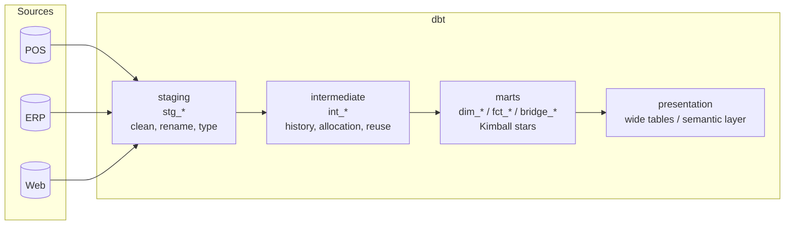

# Kimball, Inmon, Data Vault and One Big Table

<KimballRef chapters={[1]} techniques={['Enterprise data warehouse bus architecture']}>
Chapter 1 contrasts the Kimball architecture with independent data marts, the hub-and-spoke Corporate Information
Factory (Inmon), and hybrids.
</KimballRef>

Dimensional modeling is one of several approaches you'll meet. Knowing the differences helps you defend design
choices, and recognize when teams combine them.

## The main approaches

| | **Kimball (dimensional, bus architecture)** | **Inmon (CIF / enterprise DW)** | **Data Vault 2.0** | **One Big Table (OBT)** |
|---|---|---|---|---|
| Core structure | Star schemas per business process, integrated by **conformed dimensions** | Normalized (3NF) enterprise warehouse feeding departmental marts | Hubs (keys), links (relationships), satellites (history) | One very wide denormalized table per use case |
| Built for | Business users and BI queries | Enterprise integration; marts built downstream | Auditability, parallel loading, source-change resilience | Simplicity for a single tool or ML feature set |
| Integration happens | In conformed dimensions, process by process | In the central normalized model | In hubs/links (raw vault), then business vault | Usually not at all; each OBT stands alone |
| Users query | The stars directly | Downstream marts (often dimensional!) | Downstream marts (often dimensional!) | The table directly |
| History | Slowly changing dimensions | Time-stamped normalized tables | Satellites (insert-only) | Usually whatever the build captured |

Notice the pattern: **Inmon and Data Vault both usually present data to users through dimensional marts.**
Dimensional modeling is the near-universal *presentation* layer, whatever sits beneath it.

## Where Kimball sits in a dbt project

The dbt community's standard layering lines up cleanly with Kimball:



- **Staging** is close to the source, with no business logic. Kimball would call this part of the ETL "back room".
- **Intermediate** holds reusable transformations: SCD history construction, allocations, deduplication.
- **Marts** are the dimensional model: the "front room" presentation area that Kimball designs.
- **Presentation extras**, such as wide denormalized tables for a specific tool or a semantic layer, sit *on top of*
  the stars and are rebuilt from them.

## The "One Big Table" debate

With columnar warehouses, some teams skip stars and build OBTs. Kimball's position, applied to today's tools:

**OBTs are a fine *output*.** Joining a fact to its dimensions into a wide table for a dashboard or an ML
feature set is cheap in Snowflake, and some tools prefer it.

**OBTs are a poor *foundation*:**

- Every OBT re-derives dimension logic, so definitions drift between tables.
- Changing one dimension attribute means rebuilding every table that copied it.
- History is frozen however that OBT happened to be built; there's no "as was" vs "as is" choice.
- Mixing grains in one wide table is easy and silent.

The pragmatic pattern: **model stars, then materialize wide tables from them where a tool needs it.**

```sql
-- models/presentation/retail_sales_wide.sql
select
    f.*,
    d.full_date, d.year_month, d.fiscal_year_quarter, d.weekday_indicator,
    p.sku, p.product_name, p.brand, p.category, p.department,
    s.store_name, s.store_region,
    pr.promo_name
from {{ ref('fct_retail_sales') }} f
join {{ ref('dim_date') }} d       using (date_key)
join {{ ref('dim_product') }} p    using (product_key)
join {{ ref('dim_store') }} s      using (store_key)
join {{ ref('dim_promotion') }} pr using (promotion_key)
```

<Quiz questions={[
  {question: 'In Kimball\'s bus architecture, what integrates data across business processes?', options: ['A normalized enterprise model', 'Conformed dimensions', 'Data Vault hubs', 'A single fact table'], answer: 1, explanation: 'Conformed dimensions (and conformed facts) are the integration mechanism. Each process gets its own star, all sharing the same dimensions.'},
  {question: 'What is the main risk of building every dashboard on its own One Big Table?', options: ['Snowflake cannot store wide tables', 'Business definitions and dimension logic drift between tables', 'Wide tables are always slower', 'OBTs cannot be built with dbt'], answer: 1, explanation: 'Without shared, conformed dimensions underneath, each OBT re-implements categories, calendars and history differently.'},
]} />
