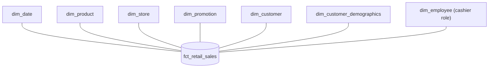

# Anatomy of a star schema

<KimballRef chapters={[1, 2]} techniques={['Fact table structure', 'Dimension table structure', 'Star schemas and OLAP cubes', 'Graceful extensions to dimensional models']} />

## The fact table

A fact table records the **measurements** from a business process. Structurally it is:

- **Foreign keys** to each dimension (together they usually identify the row);
- optionally **degenerate dimensions**: identifiers like a ticket number, with no dimension table of their own;
- **numeric facts**, preferably *additive* ones such as quantities and extended amounts.

It is **deep and narrow**: many rows, relatively few columns. Every row is at the **same grain**.

| `date_key` | `product_key` | `store_key` | `promotion_key` | `transaction_id` | `line_number` | `sales_quantity` | `extended_net_sales_amount` |
|---|---|---|---|---|---|---|---|
| 20250301 | `8f3a…` | `c41d…` | `9e0b…` | 532118 | 1 | 2 | 378.00 |
| 20250301 | `51bc…` | `c41d…` | `9e0b…` | 532118 | 2 | 1 | 24.00 |

## The dimension table

A dimension table holds the **descriptive context** for the facts. It is:

- **Wide and shallow**: dozens or hundreds of descriptive columns, few rows compared with the facts;
- **Denormalized**: hierarchies are flattened into the row (product → subcategory → category → department);
- **Verbose**: values are human-readable labels ("Weekend", not `Y`), because they show up on reports;
- keyed by a **surrogate key** that the fact table references.

| `product_key` | `sku` | `product_name` | `brand` | `subcategory` | `category` | `department` | `price_band` |
|---|---|---|---|---|---|---|---|
| `8f3a…` | SKU-2003 | Ridge Runner Boot | Talus | Hiking Boots | Footwear | Hiking | $150 - $299 |

:::tip Kimball's shorthand
**Facts are what you measure; dimensions are how you describe and slice the measurements.**
If you'd put it in a `GROUP BY` or `WHERE`, it's a dimension attribute. If you'd put it inside `SUM()`, it's a fact.
:::

## Keys

| Key | What it is | Example in the lab |
|---|---|---|
| **Natural key** | The identifier from the source system | `sku = 'SKU-2003'` |
| **Surrogate key** | A warehouse-assigned key with no business meaning; one per dimension *row* (version) | `product_key` |
| **Durable key** | A warehouse-assigned key that stays the same for an entity across all its versions | `product_durable_key` |

You'll learn why the fact table stores surrogate keys rather than natural keys in [Surrogate keys](/dimensions/surrogate-keys).

## The star

Put the fact table in the middle and the dimensions around it, and you get the shape that names the technique:



Every dimension is **one join away** from the fact table. Contrast this with a **snowflake schema**, where
dimensions are normalized into chains (`product → subcategory → category → department`). Kimball recommends
against snowflaking for presentation; see [Snowflaking and outriggers](/dimensions/outriggers-and-snowflaking).

## Graceful extensions

A well-designed star absorbs change without breaking existing queries:

- **New dimension attribute** (say `product.is_sustainable`): add a column. Old queries are unaffected.
- **New dimension** (say a `weather` dimension), *if it's single-valued at the existing grain*: add a foreign key
  column. Historical rows point to an "unknown"/"not recorded" member.
- **New fact** at the same grain: add a column.
- **Finer grain:** if the fact table already holds atomic data, new detail usually arrives as new dimensions.
  This is why Kimball insists on [atomic grain](./declaring-the-grain).

## In dbt

The retail sales star lives in `dbt/models/marts/`:

```text
models/marts/
├── core/                    # conformed dimensions used by every process
│   ├── dim_date.sql
│   ├── dim_product.sql
│   ├── dim_store.sql
│   ├── dim_customer.sql
│   └── ...
└── retail/
    ├── fct_retail_sales.sql
    └── fct_promotion_coverage.sql
```

Here's the store dimension: small, Type 1, with the geographic hierarchy flattened into the row and a special
"Unknown" member at the end.

<DbtFile path="models/marts/core/dim_store.sql" />

<Quiz questions={[
  {question: 'A column "unit_price" is on the POS line. Why does the lab fact table store extended_gross_sales_amount (quantity x price) instead?', options: ['Unit price is a dimension attribute', 'Extended amounts are additive; unit prices are not', 'Snowflake cannot sum decimals', 'It is smaller to store'], answer: 1, explanation: 'Summing unit prices across rows is meaningless; summing extended amounts gives correct totals at any level. The unit price can always be derived by division.'},
  {question: 'Which of these is a degenerate dimension in fct_retail_sales?', options: ['store_key', 'transaction_id', 'sales_quantity', 'date_key'], answer: 1, explanation: 'The POS ticket number is a dimension-like identifier with no attributes of its own, so it sits in the fact table without a dimension table.'},
  {question: 'What makes a snowflake schema different from a star schema?', options: ['It has more fact tables', 'Dimension hierarchies are normalized into separate tables', 'It only works on Snowflake', 'It has no surrogate keys'], answer: 1, explanation: 'Snowflaking normalizes dimensions into chains of tables. The name has nothing to do with the Snowflake database.'},
]} />
