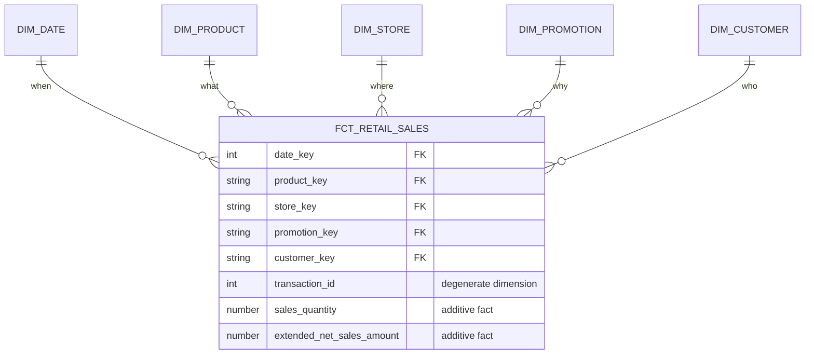

# Why dimensional modeling

<KimballRef chapters={[1]} techniques={['Star schemas and OLAP cubes', 'Dimensions for descriptive context', 'Facts for measurements']}>
Chapter 1 sets out the goals of a DW/BI system and introduces facts, dimensions and the star schema.
Read it first if you read nothing else.
</KimballRef>

## The problem

Operational systems (the point-of-sale system, the ERP, the e-commerce database) are designed to **process
transactions**: insert one order, update one customer's address, and do it thousands of times a second without
anomalies. That's what third normal form (3NF) is for. Every fact is stored exactly once, so updates are cheap
and consistent.

Analysts want the opposite. They rarely touch one row; they want **millions of rows summarized, sliced and
compared**:

> "Net sales by product category by month for Northwest stores, this year vs last year, promotion vs no promotion."

Against a 3NF schema that question means joining a dozen tables: line items to tickets to registers to stores to
districts to regions, products to subcategories to categories to departments, plus a calendar built on the fly. It's
hard to write, easy to get wrong, slow to run, and different analysts end up with different answers.

## The dimensional answer

A dimensional model reorganizes the same data around **how the business measures and describes itself**:

- **Facts** are the numeric measurements of a business process event: quantity sold, dollars sold, cost.
  They live in a **fact table**, one row per measurement event at a declared **grain**.
- **Dimensions** are the descriptive context: the *who, what, where, when, why and how* of the event. They live
  in wide, denormalized **dimension tables** whose columns become filters, groupings and labels.



The query above becomes one fact table joined to four dimensions, each joined **once**, on a single key:

```sql
select
    d.year_month,
    p.category,
    pr.promo_code <> 'NONE'              as on_promotion,
    sum(f.extended_net_sales_amount)     as net_sales
from fct_retail_sales f
join dim_date d       on d.date_key = f.date_key
join dim_product p    on p.product_key = f.product_key
join dim_store s      on s.store_key = f.store_key
join dim_promotion pr on pr.promotion_key = f.promotion_key
where s.store_region = 'Northwest'
  and d.calendar_year = 2025
group by all
order by 1, 2;
```

Every star query looks like this: **filter and group on dimension attributes, aggregate fact columns**. That
regularity is why BI tools, semantic layers and query optimizers all love star schemas.

## Why it still matters with Snowflake and dbt

"Storage is cheap and Snowflake is fast, so why not just query the raw tables?" Three reasons:

1. **Understandability doesn't scale with compute.** A faster warehouse doesn't tell an analyst which of three
   `status` columns is the right one, or that `amount` on the order header must not be summed across lines.
   The dimensional model bakes those decisions in once.
2. **Consistency across processes.** Conformed dimensions (one `dim_product`, one `dim_date`) mean sales,
   inventory and procurement all slice by the *same* category and the *same* fiscal calendar. Without them, every
   dashboard reinvents the calendar and the numbers never tie.
3. **History.** Source systems overwrite. Kimball's slowly changing dimension techniques preserve what was true
   *at the time*, which raw tables often can't tell you.

Kimball's model also maps neatly onto the dbt way of working: **staging models** clean the sources,
**intermediate models** do reusable heavy lifting, and **marts** are the dimensional presentation layer. You'll
build exactly that throughout this guide.

## Pitfalls

- **Treating "dimensional" as "denormalize everything into one table".** A wide table can be a useful
  *presentation* artifact (see [One Big Table](./modeling-approaches)), but it isn't the model. You still need the
  grain, conformed dimensions and history decisions underneath.
- **Modeling reports instead of business processes.** A table per dashboard produces dozens of slightly different
  versions of the truth. Model the *process* (retail sales); many reports then read from it.

<Quiz questions={[
  {question: 'Which statement best describes why operational (OLTP) schemas are normalized?', options: ['To make analytical queries fast', 'To make individual inserts and updates cheap and free of anomalies', 'Because dimensional modeling did not exist yet', 'To reduce the number of tables'], answer: 1, explanation: 'Normalization stores each fact once so updates are consistent. Great for processing transactions, awkward for analysis.'},
  {question: 'In a star schema, which table typically has the most rows?', options: ['The date dimension', 'The product dimension', 'The fact table', 'They are about the same'], answer: 2, explanation: 'Fact tables hold one row per measurement event and are usually orders of magnitude larger than any dimension.'},
  {question: 'An analyst wants to group sales by product category. Where should "category" live?', options: ['As a column on the fact table', 'In the product dimension', 'In a separate category table joined to the product table', 'Computed in the BI tool'], answer: 1, explanation: 'Descriptive attributes used for filtering and grouping belong in dimensions, denormalized into the product dimension rather than snowflaked out.'},
]} />
