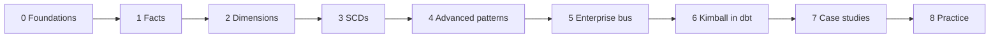

import ProgressTracker from '@site/src/components/Progress/ProgressTracker';

# Kimball Refresh

A study guide for **dimensional modeling the Kimball way**, built for people who ship models in **dbt** on **Snowflake**.

Every technique on this site:

1. is named the way the Kimball Group names it, and cited to the chapter of
   *The Data Warehouse Toolkit, 3rd Edition* (Kimball & Ross) where it's taught;
2. is explained in plain language with a concrete example from one fictional company;
3. is **implemented as a real dbt model** in the companion project (`dbt/` in the repo). The code you
   read on these pages is pulled straight from that project at build time, so it can't drift out of date.

:::info This is a companion, not a replacement
The explanations here are original, written to help you *practice*. They point you to the book and to the
[Kimball Group's technique list](https://www.kimballgroup.com/data-warehouse-business-intelligence-resources/kimball-techniques/dimensional-modeling-techniques/)
for the authoritative treatment. If you can, keep a copy of *The Data Warehouse Toolkit* (3rd ed.) open alongside.
The [Reading guide](/reference/reading-guide) maps each chapter to the lessons here.
:::

## Meet Cascade Outfitters

All the examples use one company, so you can watch **conformed dimensions** knit separate business processes
together, which is the whole point of Kimball's bus architecture.

**Cascade Outfitters** sells outdoor gear through five physical stores in the Northwest and Mountain regions and
a web store. It has:

| Business process | Source data in the lab | Fact tables you'll build |
|---|---|---|
| Point-of-sale retail sales | POS ticket lines | `fct_retail_sales`, `fct_promotion_coverage` |
| Store inventory | Daily on-hand counts, movements | `fct_inventory_daily_snapshot`, `fct_inventory_transactions` |
| Procurement | PO issued / received / invoiced / paid | `fct_procurement_transactions`, `fct_po_line_pipeline` |
| Web order management | Order headers, lines, shipments, FX rates | `fct_order_lines`, `fct_order_fulfillment` |
| General ledger | Journal lines, chart of accounts, budget | `fct_gl_journal_lines`, `fct_gl_monthly_balance`, `fct_budget_vs_actual` |
| Human resources | Employee events, reporting lines | `fct_employee_events`, `fct_headcount_monthly` |

## How to use this guide

- **New to dimensional modeling?** Go in order. Modules 0 to 3 are the core every modeler needs cold.
- **Refreshing?** Skim the [cheat sheet](/reference/cheat-sheet), take the quizzes at the end of each lesson, and spend your
  time on modules 4, 5 and 7.
- **Preparing for an interview or a design review?** Go to [Practice](/practice) and the
  [interview questions](/practice/interview-questions).

Each lesson follows the same shape:

1. **Kimball source**: the chapter and technique names.
2. **The idea**, in plain language.
3. **The design**: an ERD and the grain declaration.
4. **The dbt implementation** from the lab project.
5. **Querying it**: the business questions it answers, in Snowflake SQL.
6. **Pitfalls**: how this goes wrong in real projects.
7. **Quiz and exercise**, with hidden solutions.

## Your progress

Click **Mark lesson complete** at the bottom of each lesson. Progress is saved in this browser only.

<ProgressTracker />

## Get the lab running

Reading is not enough: the [lab setup](/setup) gets the dbt project building in your Snowflake account in
about 15 minutes, so you can query every model, break things and watch the tests catch them.
