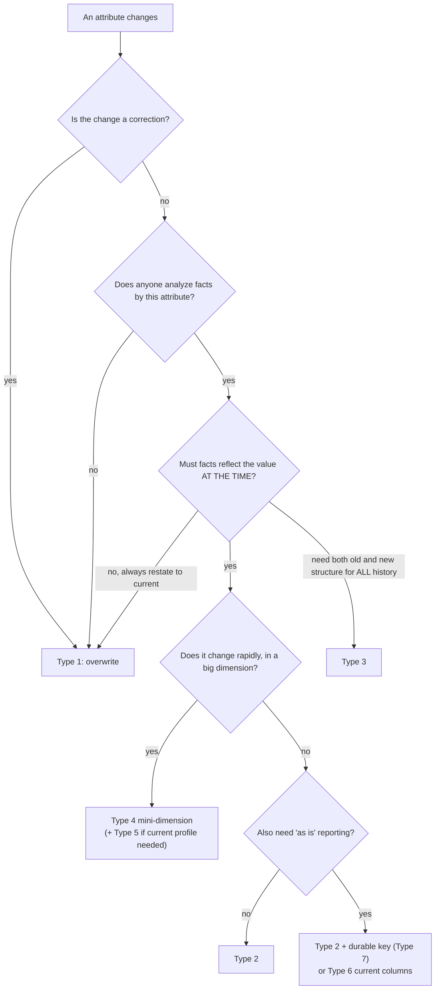

# Choosing an SCD strategy

<KimballRef chapters={[5, 18]} techniques={['Type 1: Overwrite', 'Type 2: Add New Row', 'Type 4: Add Mini-Dimension', 'Type 7: Dual Type 1 and Type 2 Dimensions']}>
Kimball recommends recording the SCD decision for every attribute in the detailed design (Ch. 18).
</KimballRef>

SCD type is decided **per attribute**, with business users, and documented. A practical decision path:

Also consider **Type 0** for attributes that are definitionally "original" or "at signup".

## The lab's choices

| Dimension | Attribute | Type | Why |
|---|---|---|---|
| `dim_product` | brand, category, department, package_size | 2 | Merchandising analyzes by them and wants history |
| `dim_product` | product_name, subcategory | 1 | Corrections and renames; no analytic need for history |
| `dim_product` | (durable key on facts) | 7 | Cheap "as is" reporting |
| `dim_customer` | city, state, loyalty tier | 2 | Regional and loyalty analysis "as was" |
| `dim_customer` | name, email | 1 | Corrections; PII you don't want duplicated across versions |
| `dim_customer_demographics` | age band, income band, tier | 4 | Volatile; banded |
| `dim_employee` | job title, home store | 2 | HR analysis by role and location over time |
| `dim_store` | all | 1 | Store attributes rarely change and are restated |

## Practice scenarios

1. A customer's <strong>marital status</strong> changes. Marketing segments campaigns by it and wants to know what segment a customer was in when they responded.

**Type 2**, or a **mini-dimension** if the customer dimension is very large and several such demographic
attributes change. "When they responded" is the "at the time" requirement.

2. The <strong>product category hierarchy is reorganized</strong> on Feb 1. Finance wants this year's budget comparison by the new categories, but last year's reports must remain reproducible.

**Type 2 plus Type 7** (durable key to a current view). Last year's reports use the surrogate key (as was);
the budget comparison uses the current view (as is). If they also want "all history by old categories" for the
transition year, add **Type 3** `prior_category`.

3. A <strong>store's phone number</strong> changes.

**Type 1.** Nobody analyzes sales by phone number.

4. A customer's <strong>credit score</strong> is refreshed monthly for 20 million customers.

**Type 4 mini-dimension** with credit-score **bands**, captured on each fact. Add a **Type 5** current-band
outrigger if collections needs "customers currently in band X". Type 2 would add up to 20 million versions a month.

5. An employee's <strong>original hire date</strong> vs <strong>most recent rehire date</strong>.

Two attributes: `original_hire_date` (**Type 0**) and `latest_hire_date` (**Type 1**). Rehire events
themselves belong in the HR events fact.

6. A <strong>sales rep's territory</strong> changes; commissions are paid on the territory at the time of the sale, but the sales VP wants a dashboard of each rep's lifetime sales under their current territory.

**Type 2** on the rep dimension (commission accuracy) with the **durable key on the fact (Type 7)** for the
lifetime-under-current-territory dashboard. **Type 6** works too if the BI tool prefers one dimension table.

<Quiz questions={[
  {question: 'Who should decide whether an attribute is Type 1 or Type 2?', options: ['The dbt developer, based on convenience', 'The business, based on how they analyze history, documented in the design', 'The source system owner', 'Whoever writes the snapshot'], answer: 1, explanation: 'SCD choices encode business requirements about history and must be agreed and documented.'},
]} />
