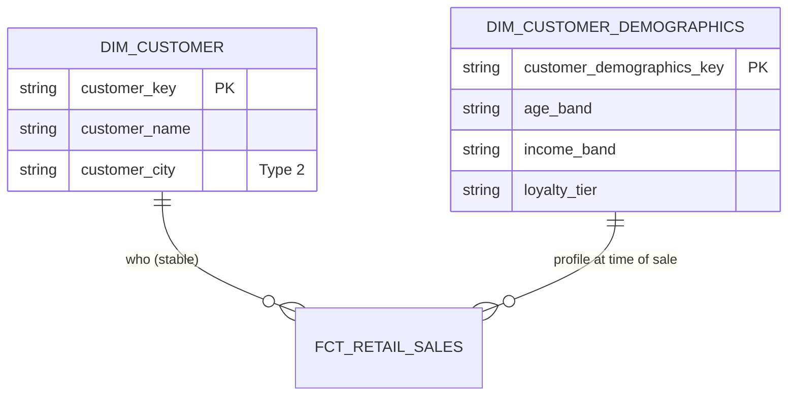

# Type 4: mini-dimensions

<KimballRef chapters={[5, 8, 10, 16]} techniques={['Type 4: Add Mini-Dimension', 'Dynamic Value Bands']}>
Ch. 5 defines Type 4; it reappears for customer behaviour (Ch. 8), banking (Ch. 10) and insurance (Ch. 16), all
large, volatile customer dimensions.
</KimballRef>

## The problem

A customer dimension with 10 million rows has attributes that change **often**: age band, income band, credit
score band, loyalty tier, purchase-frequency segment. Tracking them as Type 2 means a new version per customer
every time any of them changes. The dimension explodes to hundreds of millions of rows, and most versions differ
only by a band.

## The technique

Split the volatile attributes out into a **mini-dimension**:

1. **Band** the values: ages into ranges, income into ranges. Banding is what makes it *mini*.
2. Build **one row per combination** of banded values, not per customer.
3. Put **both** keys on the fact: `customer_key` (the stable dimension) and `customer_demographics_key` (the
   profile *at the time of the event*).



## In the lab

The mini-dimension is the full Cartesian product of the bands: 4 age bands × 4 income bands × 3 tiers = 48 rows.

<DbtFile path="models/marts/core/dim_customer_demographics.sql" />

The fact load computes the customer's bands **as of the sale** and looks up the key:

<DbtFile path="models/marts/retail/fct_retail_sales.sql" lines={[42, 67]} title="fct_retail_sales.sql (profile banding)" />

## Querying

```sql
-- Sales by the customer's age band AT THE TIME of purchase
select d.age_band, d.income_band, sum(f.extended_net_sales_amount) as net_sales
from fct_retail_sales f
join dim_customer_demographics d on d.customer_demographics_key = f.customer_demographics_key
where d.age_band <> 'Unknown'
group by all
order by d.age_band, d.income_band;
```

## Trade-offs

| | Type 2 on the customer | Type 4 mini-dimension |
|---|---|---|
| Dimension size | Explodes | Base dimension stable; mini-dim tiny |
| "Profile at time of event" | Via the version | Via the fact's mini-dim key |
| "Current profile of a customer" | Current row | **Not directly**: needs the fact or a [Type 5](./types-5-6-7) outrigger |
| Profile of customers with **no** events | Available | Not captured (no fact row to carry it) |

That last row explains the pattern Kimball pairs with mini-dimensions: a **factless "profile change" fact**
(customer × mini-dim × effective date) when you need the profile timeline regardless of purchases.

## Dynamic value bands

Bands fixed in the mini-dimension are inflexible. Ad hoc banding of a *fact* ("accounts with balances of
$0–$1k, $1k–$5k…") is better done with a small **band definition table** joined with a range predicate:

```sql
select b.band_label, count(*) as accounts, sum(f.ending_balance_amount) as balance
from fct_account_monthly_balance f
join balance_bands b
  on f.ending_balance_amount >= b.lower_bound and f.ending_balance_amount < b.upper_bound
group by all;
```

<Quiz questions={[
  {question: 'Why must mini-dimension attributes be banded?', options: ['Bands are prettier', 'Banding keeps the number of combinations, and so the mini-dimension, small', 'dbt cannot store raw numbers', 'Bands are additive'], answer: 1, explanation: 'Raw values (exact income, exact age) would produce a row per customer, defeating the purpose.'},
  {question: 'With a Type 4 mini-dimension only, how do you find a customer\'s CURRENT demographic profile?', options: ['From dim_customer directly', 'From their most recent fact row, or a Type 5 outrigger on the customer dimension', 'From the mini-dimension\'s current flag', 'It is impossible'], answer: 1, explanation: 'Type 4 links profile to customer only through facts. Type 5 adds the current mini-dim key to the base dimension.'},
]} />
